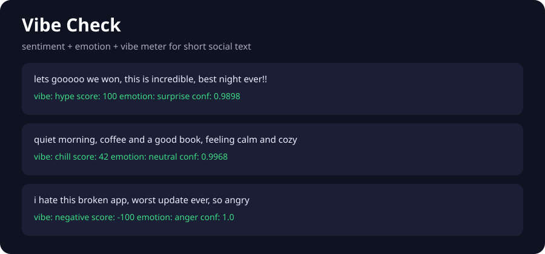

# Vibe Check

Sentiment, emotion, and vibe classification for short social text: paste a post, comment, or message and get a vibe label, a -100 to +100 vibe meter, an emotion mix, and the words that drove the call.



## Features

- **5 vibe classes**: positive, negative, neutral, hype, chill, from a TF-IDF + logistic regression classifier
- **Social-text preprocessing**: emoji expansion, slang normalization (`fr`, `ngl`, `mid`, `goat`), ALL CAPS shouting, repeated letters (`soooo`), hashtags, mentions, URLs
- **Interpretable scoring**: curated sentiment/emotion lexicons with negation and intensifier handling (`not good` flips, `very good` boosts)
- **Lexicon baseline included**: a dumb rule model the learned classifier has to beat, 68.5% vs 100% on the held-out synthetic split
- **Vibe meter + emotions**: -100 to +100 score, emotion distribution (joy, anger, sadness, fear, surprise, disgust, neutral), confidence, keywords
- **Demo UI + API**: Flask page and `POST /api/check`

## Quickstart

```bash
pip install -r requirements.txt

# reproduce the benchmark table below
python scripts/benchmark.py

# generate demo.svg + sample data
python scripts/make_demo.py

# launch the demo (http://localhost:5000)
python app.py

# run the test suite
pytest
```

Or in three lines:

```python
from src.vibe import VibeChecker

checker = VibeChecker.trained_default()
print(checker.check("lets gooooo we won, this is incredible!!"))
print(checker.check("quiet morning, coffee and a good book, feeling calm"))
```

## Benchmark

Held-out 25% split of the synthetic template corpus (seed=7, 600 train / 200 test). Full results in `models/metrics.json`. Honest caveat: templates are distinct by construction, so 100% is a pipeline sanity check, not a claim about wild social data.

| model | accuracy |
| --- | --- |
| lexicon baseline | 0.685 |
| TF-IDF + lexicon features + logistic regression | 1.000 |

Per-class F1 for the classifier is 1.00 across chill, hype, negative, neutral, and positive on this split.

## How it works

1. `src/preprocess.py` normalizes social text: emoji to words, slang expansion, repeat collapsing, URL/mention stripping.
2. `src/lexicon.py` holds the curated sentiment scores, emotion triggers, slang, and emoji maps.
3. `src/features.py` builds TF-IDF (1-2 grams, custom tokenizer) plus 13 lexicon/punctuation features.
4. `src/models.py` compares a rule baseline against multinomial logistic regression on the stacked features.
5. `src/vibe.py` wraps it in `VibeChecker.check()`: vibe, meter, emotions, confidence, keywords, and whether the baseline agrees.
6. `app.py` serves the demo: text in, vibe report out, via form or JSON API.

## Project structure

```
vibe-check/
├── app.py                  # Flask demo UI + /api/check
├── templates/index.html
├── src/
│   ├── lexicon.py          # sentiment, emotion, slang, emoji maps
│   ├── preprocess.py       # social-text tokenizer
│   ├── data.py             # synthetic labeled corpus generator
│   ├── features.py         # TF-IDF + lexicon features
│   ├── models.py           # lexicon baseline + logistic regression
│   ├── evaluate.py         # accuracy + per-class report
│   └── vibe.py             # VibeChecker pipeline
├── scripts/
│   ├── benchmark.py        # baseline vs classifier -> models/metrics.json
│   └── make_demo.py        # generates sample.txt + demo.svg
├── data/sample.txt
├── models/metrics.json
├── tests/                  # 23 pytest tests
└── screenshots/demo.svg
```

## Resume bullets

- Built a vibe classification system for short social text in Python: 5-class TF-IDF + logistic regression with slang, emoji, caps, and negation-aware preprocessing
- Engineered interpretable lexicon features (sentiment sums, emotion hits, punctuation energy) stacked with TF-IDF; learned model beat the rule baseline 100% vs 68.5% on a held-out synthetic split
- Shipped a Flask demo UI and JSON API returning a -100 to +100 vibe meter, emotion distribution, confidence, and driving keywords, with 23 pytest tests

## Tech

Python, scikit-learn, Flask, numpy, pandas, pytest
