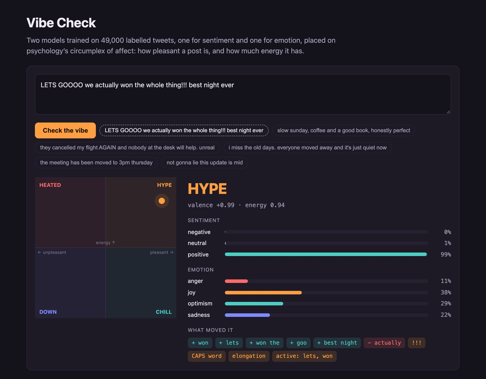
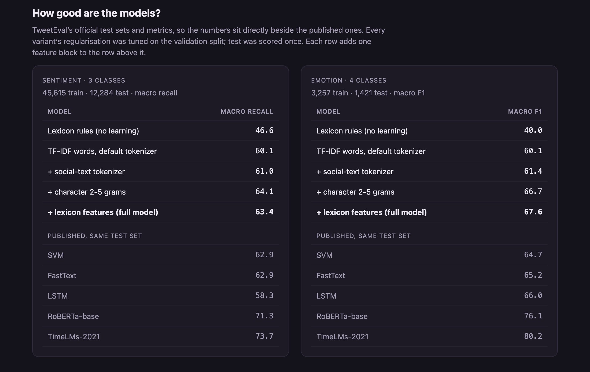

# Vibe Check

[](https://github.com/otawfik/vibe-check/actions/workflows/ci.yml)

Paste a post and see where it lands on psychology's circumplex of affect: how pleasant it is, and how much
energy it has. Two models trained on 49,000 labelled tweets from TweetEval do the reading, one for sentiment and one
for emotion. Both are benchmarked against the published TweetEval results on the official test sets.



## Results

TweetEval ([Barbieri et al., 2020](https://arxiv.org/abs/2010.12421)), official splits and official metrics:
macro-averaged recall for sentiment, macro-F1 for emotion. Each variant's regularisation strength was tuned on the
validation split; the test split was scored once. Each row adds one feature block to the row above.

| model | sentiment (macro recall) | emotion (macro F1) |
| --- | ---: | ---: |
| Lexicon rules, no learning | 46.6 | 40.0 |
| TF-IDF words, default tokenizer | 60.1 | 60.1 |
| + social-text tokenizer | 61.0 | 61.4 |
| + character 2–5 grams | **64.1** | 66.7 |
| + lexicon features (full model) | 63.4 | **67.6** |
| *Published:* SVM | 62.9 | 64.7 |
| *Published:* FastText | 62.9 | 65.2 |
| *Published:* LSTM | 58.3 | 66.0 |
| *Published:* RoBERTa-base | 71.3 | 76.1 |
| *Published:* TimeLMs-2021 | 73.7 | 80.2 |

What the numbers say:

- **A linear model edges past every published non-transformer baseline on both tasks.** The margins are modest
  (+0.5 over SVM and FastText on sentiment, +1.6 to +2.9 on emotion), and transformers still lead by 8–13 points. This is a
  fast, inspectable model that runs on any laptop, not a state-of-the-art claim.
- **Character n-grams are the biggest single gain** (+3.1 sentiment, +5.3 emotion). Tweets are full of
  elongations, misspellings and hashtags that a word vocabulary treats as unseen; character fragments still match.
- **The hand-built lexicon doesn't help sentiment.** It won on validation by 0.2 and lost on test by 0.6, which is
  no effect. It helps emotion by about a point, where the training set is 14 times smaller and prior knowledge
  matters more. The full model is the one picked on validation, so that's the one deployed.
- **Errors are mostly about neutral.** In sentiment, 26% of neutral tweets are called negative, while only 7% of
  positive and negative tweets are called the opposite polarity. In emotion, optimism is the hard class at 50% recall:
  it has the fewest examples and overlaps with joy.



## How the vibe is placed

The circumplex model of affect ([Russell, 1980](https://doi.org/10.1037/h0077714)) describes a feeling on two
axes. Vibe Check estimates both from the two models:

- **Valence** = P(positive) − P(negative) from the sentiment model, in [−1, 1].
- **Energy** = the emotion model's probabilities weighted by where each emotion sits on the arousal axis
  (anger 0.85, joy 0.70, optimism 0.35, sadness 0.20), plus capped nudges for how a post is typed (exclamation
  marks, CAPS, elongated words) and for a short list of calm or activated words.

The quadrants are hype (pleasant, high energy), chill (pleasant, low), heated (unpleasant, high) and down
(unpleasant, low), with neutral for posts the sentiment model calls neutral and that sit near the centre. Nothing
was trained on "hype" or "chill" labels. The quadrants are a reading of two real models, and the arousal placements
and nudges are hand-set constants in [`src/vibe.py`](src/vibe.py), where you can see them. The calm-word cue exists
because TweetEval's four emotions have no calm-pleasant class: without it, a slow Sunday with coffee reads as
high-energy joy.

"What moved it" lists the words and bigrams pushing valence up or down, computed from the sentiment model's own
weights (TF-IDF value × the positive-minus-negative coefficient). Character n-grams and stopwords are left out
because they aren't readable as reasons.

## Run it

```bash
pip install -r requirements.txt

python scripts/benchmark.py   # downloads TweetEval, runs the ablation (~5 min), writes models/metrics.json
python app.py                 # http://localhost:5000
pytest                        # 36 tests, offline, under a second
```

The demo loads the two trained models on first request, from `artifacts/` if you've run the benchmark, otherwise
from the [v1.0 release](https://github.com/otawfik/vibe-check/releases/tag/v1.0) (6.6 MB, SHA-256 checked before
it's loaded). TweetEval itself isn't redistributed here; the loader fetches it from the
[TweetEval repository](https://github.com/cardiffnlp/tweeteval) and caches it.

The tests use a tiny synthetic corpus so they run offline. They cover the TweetEval loader (including misaligned
files), every ablation variant, the official metrics, the quadrant rules and cues, the word-level explanations, and
the API.

## Layout

```
src/
  data.py        TweetEval loader + toy corpus for tests
  preprocess.py  social-text tokenizer: emoji, slang, elongation, mentions, URLs
  lexicon.py     sentiment, emotion, slang, emoji and arousal word lists
  features.py    word TF-IDF, character n-grams, lexicon features (each switchable)
  models.py      rule baseline, ablation variants, class-balanced logistic regression
  evaluate.py    TweetEval's official metric per task
  vibe.py        circumplex placement and word-level explanations
scripts/benchmark.py
app.py, templates/index.html
models/metrics.json
```

## Limits

- Trained on tweets from the SemEval 2017 and 2018 shared tasks. Newer slang the tokenizer hasn't seen falls back to
  character n-grams.
- Four emotions can't cover the space: there's no fear, surprise or calm contentment, which is why energy needs
  the hand-set cues.
- Sarcasm reads as its literal sentiment.

Python · scikit-learn · SciPy · NumPy · Flask · pytest
